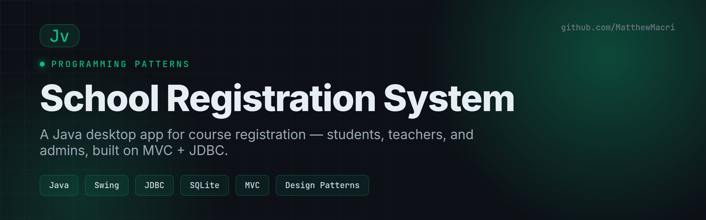

# School Registration System

> A Java desktop application for course registration — students, teachers, and administrators, built on an MVC architecture with JDBC and design patterns.


Built for **Programming Patterns (420-301-VA)** at Vanier College.

---

## Overview

The School Registration System simplifies course management for three roles — **students**, **teachers**, and **administrators**. It's a practical application of object-oriented design, data structures, and software design patterns, built on an **MVC** architecture with a **JDBC**-backed SQLite database and a bilingual (English / French) interface.

## Features

### 🎓 Student Portal
- Register for and drop courses with real-time seat availability
- View current and upcoming semester schedules

### 🧑‍🏫 Teacher Portal
- View course details, student lists, and schedules

### 🗂️ Administrator Portal
- Add, update, or delete courses
- Manage student enrollment
- Generate reports on courses and students

### ⚙️ Engineering
- **MVC architecture** with clear model/view/controller separation
- **Design patterns** — e.g. Factory and Singleton
- **JDBC CRUD** against an SQLite database
- **Internationalization** (I18N/L10N) with `ResourceBundle` + `Locale`
- **Collections & Stream** processing with lambdas
- **Unit tests** following a test-driven approach

## Architecture & Design

| ER Diagram | Class Diagram |
|---|---|
|  |  |

## Tech Stack

| Area | Tools |
|------|-------|
| Language | Java |
| Database | SQLite via JDBC |
| UI | Swing (GUI desktop) |
| Patterns | MVC, Factory, Singleton |
| i18n | ResourceBundle, Locale |

## Getting Started

```bash
git clone https://github.com/MatthewMacri/Programming-Patterns-Project.git
cd Programming-Patterns-Project
```

Open the project in your IDE (IntelliJ IDEA / Eclipse), ensure the SQLite JDBC driver is on the classpath, and run the main application class. A runnable JAR is included in the final deliverable.

## Project Structure

```
.
├── Deliverable_1/    # Project description + ER & Class diagrams
├── Deliverable_2/    # Core implementation
├── Deliverable_3/    # Final application & report
└── ProjectDescription.md
```

## Author

**Matthew Macri** — [LinkedIn](https://www.linkedin.com/in/m-macri/) · [GitHub](https://github.com/MatthewMacri)
